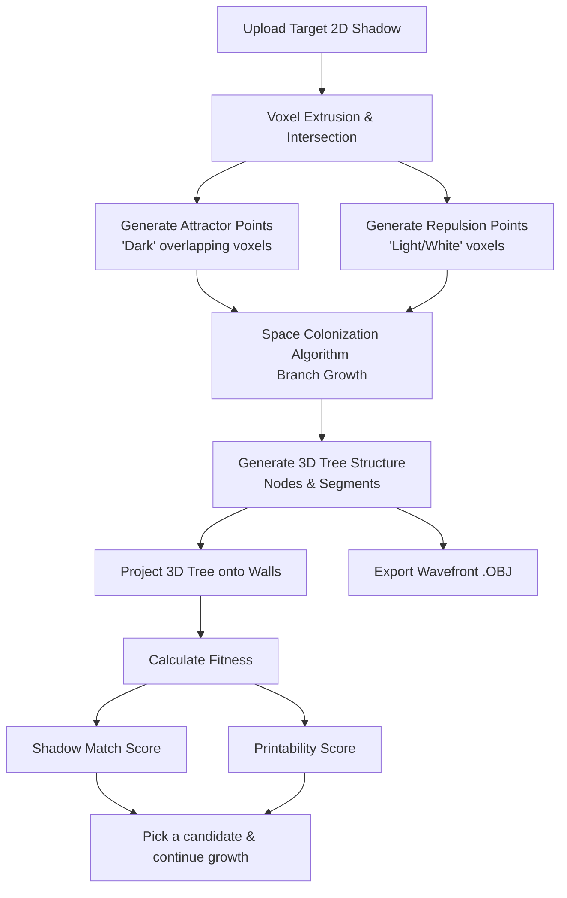

# 🌲 Shadow Evolution

**Shadow Evolution** is a generative design application that procedurally grows 3D printable structures (specifically trees) designed to cast two completely different, distinct 2D shadows when lit from orthogonal angles—essentially generating a virtual corner-lit shadow sculpture.

---

## 🗺️ System & Algorithm Flow

The system uses a custom **Multi-Projection Space Colonization Algorithm (SCA)** to grow a 3D branch network inside a bounding box so that it matches the user's uploaded target shadow masks. Each request grows several candidate trees (each with a lightly mutated parameter set); you pick one and continue growing it step by step. There is no population-based genetic evolution.



---

## 🧠 Core Algorithm Components

### 1. Voxel Intersection & Attractor Clouds ([voxel.py](backend/voxel.py))
- **Extrusion**: The target 2D shadow is extruded along the virtual light vectors (orthogonal Z and X axes) into 3D voxel rays.
- **Attractor Generation**: A 3D grid voxel search identifies locations where *both* light paths overlap with dark pixels in the target shadow. These intersections become the **Attractor Points** that draw the tree branches.
- **Repulsion Generation**: Locations that map to light (white) pixels on either shadow are designated as **Repulsion Points**. They help prevent branches from growing into areas that would create shadow false positives.

### 2. Space Colonization Algorithm ([sca.py](backend/sca.py))
- **Branch Growth**: Branch nodes grow iteratively toward the nearest attractor points within their `influence_radius` using a normalized vector direction.
- **Repulsion Force**: Nearby repulsion points (within `repulsion_radius`) push growth away, weighted by proximity, to keep silhouettes crisp. Attraction and repulsion are both normalised, so `attraction_strength` / `repulsion_strength` act as relative weights.
- **Attractor Cap**: Only a working set of up to 400 attractors is used per iteration for speed; the set is refilled as attractors are reached, and every unreached attractor is returned so growth can be continued.
- **Wiggle Factor**: Adds controlled randomness to growth directions, preventing overly straight, unnatural branches.
- **Tapering/Radius Control**: Calculates branch thicknesses dynamically by starting with leaves (thin) and accumulating radius back to the roots (thick) to ensure structural strength.

### 3. Shadow Generation & Fitness Scoring ([shadow.py](backend/shadow.py))
- **Projections**: Projects tree branches back onto simulated planes to generate the predicted shadow maps.
- **Shadow Match (Fitness)**: Compares what a viewer would *perceive* rather than raw pixels. The rendered shadow and the target are both Gaussian-blurred and thresholded (`PERCEIVED_SIGMA_FRAC`, `PERCEIVED_THRESHOLD` in `config.py`), so dense thin branches read as a filled region. Each light is scored by IoU of the two perceived masks, and the lights are combined with a harmonic mean so the weaker shadow dominates. The foot's shadow is deliberately ignored.
- **Printability** ([printability.py](backend/printability.py)): scored from the branch graph at 100 mm scale for a chosen nozzle (`0.4` default, or `0.2`). Score = thickness × overhang: branches thinner than the nozzle can print are penalised, as are branches inclined under 45° from horizontal (they need support). A root outside the standard foot scores 0. Thresholds are rules of thumb pending test prints. `POST /scenes/printability` returns the full report including checks on the built solid.


---

## 💻 Tech Stack

### Backend
* **Language**: Python 3.12+
* **Framework**: FastAPI (high-performance Web API)
* **Package Management**: `uv` (ultra-fast Python package tool)
* **Computational Libraries**:
  * `numpy`: High-performance vector math, voxel grid calculation, and distance computation.
  * `Pillow` (PIL): Image processing and pixel sampling of uploaded shadow masks.
  * `pydantic`: Schema validation and API payloads.

### Frontend
* **Core**: React 19, TypeScript, Vite
* **Styling**: TailwindCSS & Lucide Icons
* **3D Rendering**: 
  * `three` (Three.js)
  * `@react-three/fiber` (React wrapper for Three.js)
  * `@react-three/drei` (Useful helpers/controls for React Three Fiber)
* **Data Visualization**: `recharts` (for tracking evolution stats)

---

## 📁 Repository Directory Structure

```
evo/
├── backend/                 # Python FastAPI Backend
│   ├── app.py               # FastAPI App setup and CORS middleware
│   ├── main.py              # Application entrypoint
│   ├── config.py            # Bounds, wall offsets, and light configs
│   ├── models.py            # Pydantic schemas & Genome definition
│   ├── sca.py               # Main Space Colonization growth logic
│   ├── scene.py             # Wavefront OBJ exporter
│   ├── shadow.py            # Shadow projecting, drawing, and fitness scoring
│   ├── printability.py      # Printability scoring (nozzle profiles, thickness, overhang)
│   ├── mesh.py              # Tree -> watertight solid with standard foot
│   ├── connector.py         # Shared foot/peg spec (keyed sockets, clearance)
│   ├── projection.py        # Shared wall-projection (UV/pixel) helpers
│   ├── voxel.py             # Voxel intersection and attractor volume resolver
│   ├── pyproject.toml       # Backend dependencies configuration
│   ├── tests/               # pytest suite (models, projection, voxel, sca, shadow, API)
│   └── routers/             # API Endpoints
│       └── scenes.py        # /scenes/generate, /scenes/abort, /export/obj
│
├── frontend/                # React Vite Frontend
│   ├── App.tsx              # Main UI controller & generation state machine
│   ├── index.html           # SPA entry html
│   ├── index.tsx            # React bootstrap file
│   ├── vite-env.d.ts        # Vite client typings (import.meta.env)
│   ├── types.ts             # TypeScript definitions matching Python Pydantic models
│   ├── services/
│   │   └── api.ts           # API integration service
│   └── components/
│       ├── Scene3D.tsx      # R3F Canvas showing interactive 3D model, lights, & walls
│       ├── ControlPanel.tsx # Target uploads, parameters, and action buttons
│       ├── Gallery.tsx      # Carousel of generated candidates & saved sculptures
│       └── DetailModal.tsx  # Modal for details, exporting, and further evolution
│
└── tests/                   # Shared test assets
    └── images/              # Sample target shadow masks (circle-triangle.png, solids.png, ct.png, etc.); also used by backend/tests
```

---

## 🚀 Getting Started

### 1. Prerequisites
- [Node.js](https://nodejs.org/) (v18+)
- [uv](https://github.com/astral-sh/uv) (recommended) or Python 3.12+

> [!TIP]
> You can find sample shadow mask images to upload in [tests/images/](tests/images). For example, try uploading `circle-triangle.png` or `solids.png` to see how the algorithm builds a structure that projects those shapes!


---

### 2. Running the Backend
Navigate to the `backend/` directory:
```bash
cd backend
```

Install dependencies and start the FastAPI server:
```bash
uv run uvicorn main:app --reload --host 0.0.0.0
```
The backend API will run on `http://localhost:8000` (interactive docs at `/docs`).

Set `LOG_LEVEL=DEBUG` for per-candidate detail (default `INFO`).

Run the tests:
```bash
uv run pytest
```

#### API

| Endpoint | Purpose |
| --- | --- |
| `POST /scenes/generate` | Grow candidate trees from target shadows; supports continuing from `parent_nodes` + `remaining_attractors`, and `run_until_complete`. |
| `POST /scenes/abort[?request_id=…]` | Abort one in-flight generation by id, or all if no id is given. |
| `POST /export/obj` | Export the tree skeleton (vertices + line elements, no solid geometry). |
| `POST /scenes/printability[?nozzle=0.4\|0.2]` | Full printability report for a scene, plus watertight/volume checks on the built mesh. |
| `POST /export/mesh?format=stl\|obj` | Export a printable, watertight solid at 100 mm scale: tubes along the branches fused with a standard foot that has keyed sockets (see `backend/connector.py`). |

Requests are bounded (see `backend/config.py`: candidates ≤ 16, tree count ≤ 10, `max_new_nodes` ≤ 5000, ≤ 20,000 nodes per tree, images ≤ 5 MB / 4096 px, 60 s wall-clock budget). Invalid input returns 4xx.

---

### 3. Running the Frontend
Navigate to the `frontend/` directory:
```bash
cd frontend
```

Install node packages:
```bash
npm install
```

Start the development server:
```bash
npm run dev -- --host 0.0.0.0
```
Open your browser and visit `http://localhost:5173` (or the address printed in your terminal).

---

## 📤 Output & Exporting

When you are satisfied with a generated sculpture, you can open its details and export it to a Wavefront `.obj` file format. This format can be imported directly into:
- 3D slicer programs (Cura, PrusaSlicer, Bambu Studio) for 3D printing.
- Modeling software (Blender, Maya, CAD) for further aesthetics rendering, sculpting, and rigging.
