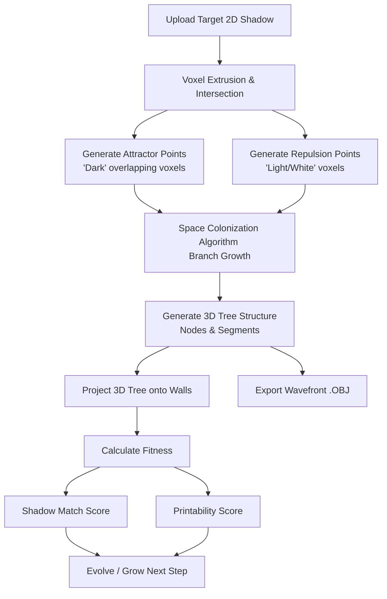

# 🌲 Shadow Evolution

**Shadow Evolution** is a generative design application that procedurally grows 3D printable structures (specifically trees) designed to cast two completely different, distinct 2D shadows when lit from orthogonal angles—essentially generating a virtual corner-lit shadow sculpture.

---

## 🗺️ System & Algorithm Flow

The system combines a custom **Multi-Projection Space Colonization Algorithm (SCA)** with simulated genetic optimization to guide the growth of a 3D branch network within a bounding box, ensuring the generated sculpture matches the user's uploaded target shadow masks.



---

## 🧠 Core Algorithm Components

### 1. Voxel Intersection & Attractor Clouds ([voxel.py](file:///home/nraatika/projects/evo/backend/voxel.py))
- **Extrusion**: The target 2D shadow is extruded along the virtual light vectors (orthogonal Z and X axes) into 3D voxel rays.
- **Attractor Generation**: A 3D grid voxel search identifies locations where *both* light paths overlap with dark pixels in the target shadow. These intersections become the **Attractor Points** that draw the tree branches.
- **Repulsion Generation**: Locations that map to light (white) pixels on either shadow are designated as **Repulsion Points**. They help prevent branches from growing into areas that would create shadow false positives.

### 2. Space Colonization Algorithm ([sca.py](file:///home/nraatika/projects/evo/backend/sca.py) & [tree_gen.py](file:///home/nraatika/projects/evo/backend/tree_gen.py))
- **Branch Growth**: Branch nodes grow iteratively toward the nearest attractor points within their `influence_radius` using a normalized vector direction.
- **Repulsion Force**: Nearby repulsion points push growth away to maintain crisp shadow silhouettes.
- **Wiggle Factor**: Adds controlled randomness to growth directions, preventing overly straight, unnatural branches.
- **Tapering/Radius Control**: Calculates branch thicknesses dynamically by starting with leaves (thin) and accumulating radius back to the roots (thick) to ensure structural strength.

### 3. Shadow Generation & Fitness Scoring ([shadow.py](file:///home/nraatika/projects/evo/backend/shadow.py))
- **Projections**: Projects tree branches back onto simulated planes to generate the predicted shadow maps.
- **Shadow Match (Fitness)**: Computes coverage (how much of the target shadow is matched) penalized by false positives (branches casting shadows in designated "light" regions).
- **Printability**: Measures structural support based on the proportion of nodes connected near the ground and checks height-to-width ratios.


---

## 💻 Tech Stack

### Backend
* **Language**: Python 3.12+
* **Framework**: FastAPI (high-performance Web API)
* **Package Management**: `uv` (ultra-fast Python package tool)
* **Computational Libraries**:
  * `numpy`: High-performance vector math, voxel grid calculation, and distance computation.
  * `Pillow` (PIL): Image processing and pixel sampling of uploaded shadow masks.
  * `pydantic`: Schema validation and API payloads.

### Frontend
* **Core**: React 19, TypeScript, Vite
* **Styling**: TailwindCSS & Lucide Icons
* **3D Rendering**: 
  * `three` (Three.js)
  * `@react-three/fiber` (React wrapper for Three.js)
  * `@react-three/drei` (Useful helpers/controls for React Three Fiber)
* **Data Visualization**: `recharts` (for tracking evolution stats)

---

## 📁 Repository Directory Structure

```
evo/
├── backend/                 # Python FastAPI Backend
│   ├── app.py               # FastAPI App setup and CORS middleware
│   ├── main.py              # Application entrypoint
│   ├── config.py            # Bounds, wall offsets, and light configs
│   ├── models.py            # Pydantic schemas & Genome definition
│   ├── sca.py               # Main Space Colonization growth logic
│   ├── scene.py             # Evolve routes and Wavefront OBJ exporter
│   ├── shadow.py            # Shadow projecting, drawing, and fitness scoring
│   ├── tree_gen.py          # Procedural baseline tree generation
│   ├── voxel.py             # Voxel intersection and attractor volume resolver
│   ├── pyproject.toml       # Backend dependencies configuration
│   └── routers/             # API Endpoints
│       └── scenes.py        # /scenes/generate, /scenes/evolve, /export/obj
│
├── frontend/                # React Vite Frontend
│   ├── App.tsx              # Main UI controller & generation state machine
│   ├── index.html           # SPA entry html
│   ├── index.tsx            # React bootstrap file
│   ├── types.ts             # TypeScript definitions matching Python Pydantic models
│   ├── services/
│   │   └── api.ts           # API integration service
│   └── components/
│       ├── Scene3D.tsx      # R3F Canvas showing interactive 3D model, lights, & walls
│       ├── ControlPanel.tsx # Target uploads, parameters, and action buttons
│       ├── Gallery.tsx      # Carousel of generated candidates & saved sculptures
│       └── DetailModal.tsx  # Modal for details, exporting, and further evolution
│
└── tests/                   # Test assets and images
    └── images/              # Sample target shadow masks (circle-triangle.png, solids.png, etc.)
```

---

## 🚀 Getting Started

### 1. Prerequisites
- [Node.js](https://nodejs.org/) (v18+)
- [uv](https://github.com/astral-sh/uv) (recommended) or Python 3.12+

> [!TIP]
> You can find sample shadow mask images to upload in [tests/images/](file:///home/nraatika/projects/evo/tests/images). For example, try uploading `circle-triangle.png` or `solids.png` to see how the algorithm builds a structure that projects those shapes!


---

### 2. Running the Backend
Navigate to the `backend/` directory:
```bash
cd backend
```

Install dependencies and start the FastAPI server:
```bash
uv run uvicorn main:app --reload --host 0.0.0.0
```
The backend API will run on `http://localhost:8000`.

---

### 3. Running the Frontend
Navigate to the `frontend/` directory:
```bash
cd frontend
```

Install node packages:
```bash
npm install
```

Start the development server:
```bash
npm run dev -- --host 0.0.0.0
```
Open your browser and visit `http://localhost:5173` (or the address printed in your terminal).

---

## 📤 Output & Exporting

When you are satisfied with a generated sculpture, you can open its details and export it to a Wavefront `.obj` file format. This format can be imported directly into:
- 3D slicer programs (Cura, PrusaSlicer, Bambu Studio) for 3D printing.
- Modeling software (Blender, Maya, CAD) for further aesthetics rendering, sculpting, and rigging.
